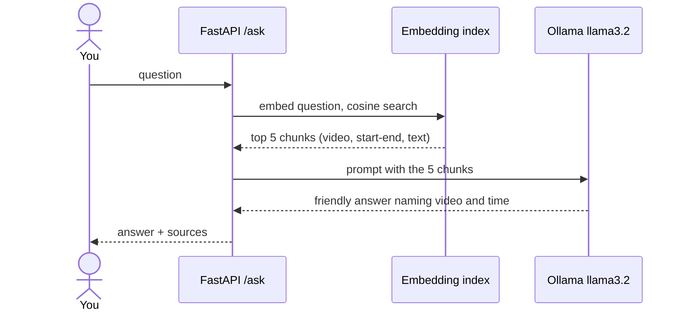
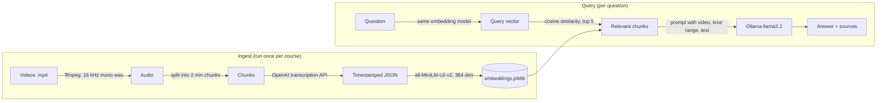

<div align="center">

# RAG Teaching Assistant

**Ask a question about a video course. Get the answer, the video, and the timestamp to watch.**


[**How it works**](#how-it-works) · [**Example**](#example) · [**Run it**](#run-it) · [**Limitations**](#limitations-and-next-steps)

| Videos indexed | Transcript chunks | Embedding size | Retrieval | Answers by |
|:---:|:---:|:---:|:---:|:---:|
| **11** | **105** | **384-dim** | **cosine, top 5** | **local llama3.2** |

</div>

The pipeline turns lecture videos into a searchable index of timestamped transcript chunks, retrieves the most relevant chunks for a question, and has a local LLM write a short answer that points back to them.

## Example

**Question:** "What is a variable in Python and how do I use it?"

Each answer comes back with its sources, so you can jump straight to the right part of the right video:

```json
{
  "question": "What is a variable in Python and how do I use it?",
  "answer": "<short answer naming the video and approximate timestamps>",
  "sources": [
    { "title": "<video title>", "number": "<video number>", "start": 120.0, "end": 240.0, "text": "<transcript chunk>" }
  ]
}
```

_Shape of the response; the values are placeholders and the answer text varies with the model._



## How it works



| Stage | File | What it does |
|---|---|---|
| 1 | `video_to_mp3.py` | Extracts 16 kHz mono `.wav` audio from every `.mp4` in `videos/` with ffmpeg |
| 2 | `mp3_to_json.py` | Splits each audio file into 2-minute chunks, transcribes each with retries, saves `jsons/<video>.json` with start and end times |
| 3 | `preprocess_json.py` | Embeds every chunk and writes `embeddings.joblib` |
| 4 | `process_incoming.py` | Embeds the question, finds the 5 closest chunks, builds the prompt and calls the local LLM |
| 5 | `main.py` + `index.html` | FastAPI `POST /ask` endpoint and a small chat page |

The index in this repo covers **11 beginner Python tutorial videos, split into 105 two-minute chunks**.

## What runs where

| Step | Runs | Needs |
|---|---|---|
| Transcription | OpenAI API (`gpt-4o-mini-transcribe`) | `OPENAI_API_KEY` |
| Embeddings | Local | `sentence-transformers` |
| Answer generation | Local, via Ollama | `ollama pull llama3.2` |

Transcription is the only step that calls a hosted API, and it is only needed to ingest new videos. Asking questions against the included index is fully local.

## Run it

```bash
pip install -r requirements.txt
ollama pull llama3.2
uvicorn main:app --port 8000
```

Open `index.html` in a browser and ask a question, or call the API directly:

```bash
curl -s localhost:8000/ask -H 'content-type: application/json' \
  -d '{"question": "What is a variable in Python and how do I use it?"}'
```

The response has `question`, `answer` and `sources` (video title, number, start and end seconds, transcript text).

<details>
<summary><b>Index your own videos</b></summary>

```bash
export OPENAI_API_KEY=...
python video_to_mp3.py      # videos/*.mp4  ->  audio/*.wav
python mp3_to_json.py       # audio/*.wav   ->  jsons/*.json
python preprocess_json.py   # jsons/*.json  ->  embeddings.joblib
```

Name videos like `01_Title.mp4`; the numeric prefix is used as the video number in answers.

</details>

<details>
<summary><b>Design choices</b></summary>

- **Fixed 2-minute chunks.** The transcription API returns text per file, so chunk boundaries (and therefore timestamps) come from the audio split, not from sentences. This gives reliable "watch minute 4 to 6" pointers at the cost of sometimes cutting an explanation in half.
- **Small local embedding model.** `all-MiniLM-L6-v2` is fast on CPU and good enough for short English lecture text.
- **Plain cosine similarity over a NumPy matrix.** With about 100 chunks a vector database adds complexity and no speed. It would be the first thing to change at thousands of chunks.
- **A scoped prompt.** The LLM is told to name the video and approximate timestamps, and to decline questions that are not about the course.

</details>

## Limitations and next steps

- **No retrieval evaluation yet.** There is no labelled question set, so retrieval quality is unmeasured. The next step is 30 to 50 questions with the correct video for each, and a hit rate at 1 and 5 compared against a keyword (BM25) baseline.
- **Timestamps are chunk-level.** Answers point to a two-minute window, not an exact moment. Word-level timestamps would fix this.
- **One language, one course.** Nothing is tuned for multilingual audio or mixed content.
- **Demo-grade serving.** CORS is open (`*`) and the page calls `127.0.0.1:8000` directly. Lock both down before exposing it.
- **Hosted demo.** Not deployed, because generation depends on a local Ollama model.
